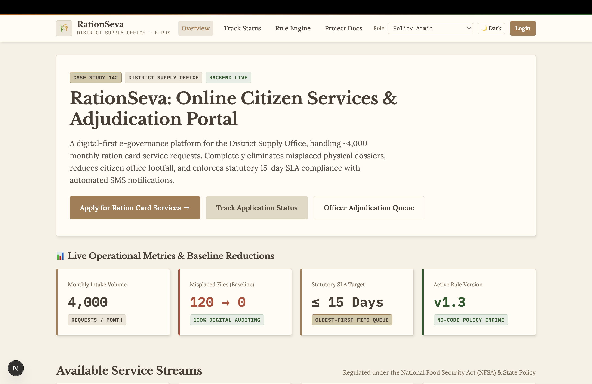
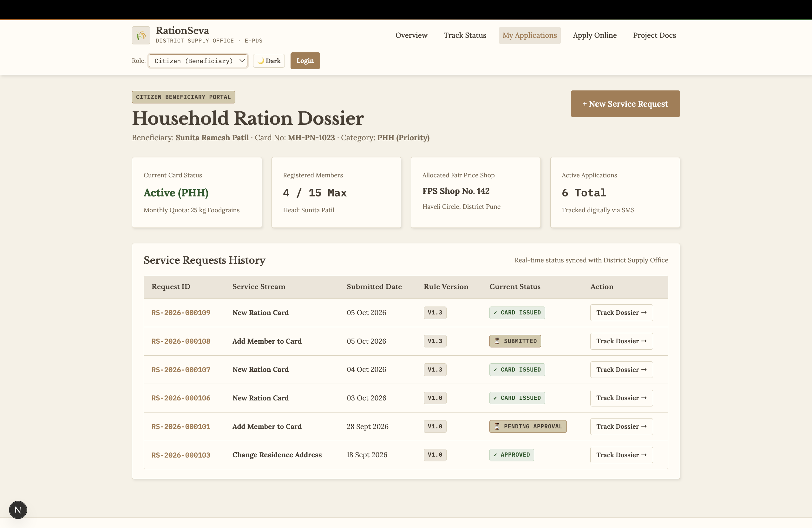
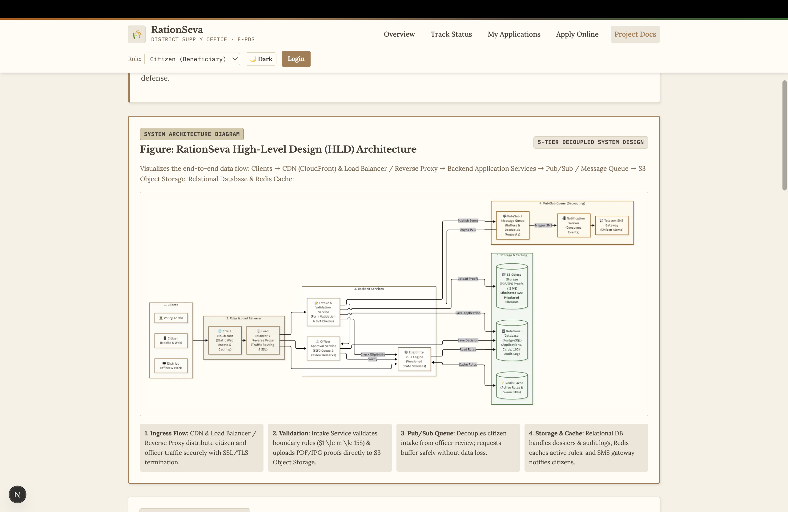
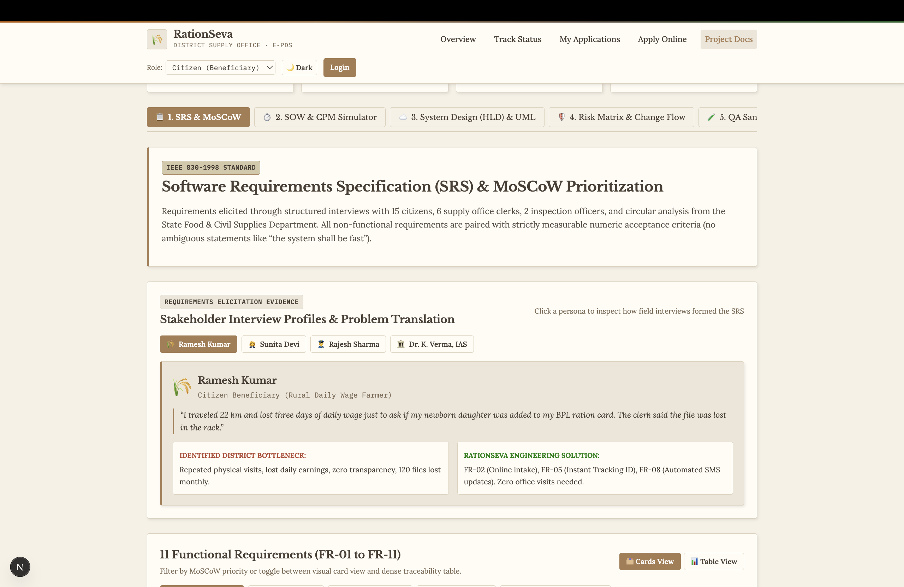
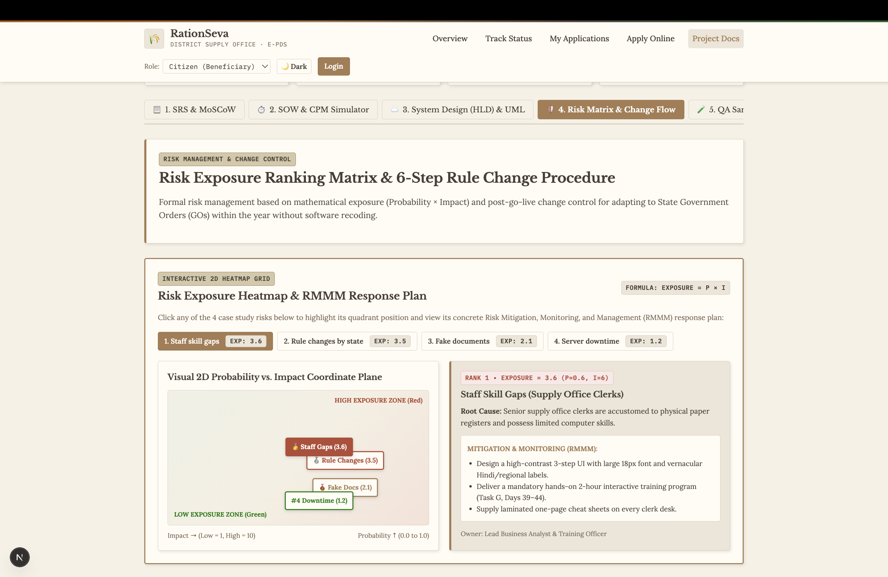
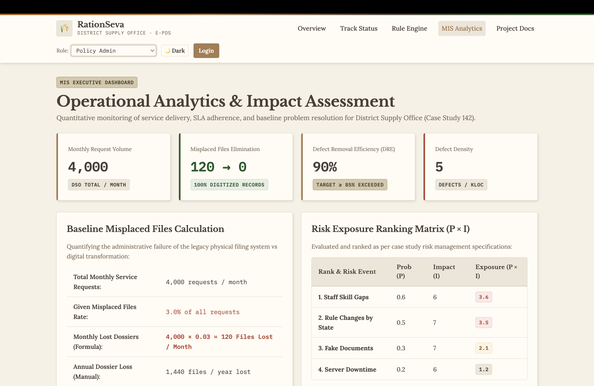

# RationSeva (राशनसेवा)

### Enterprise Public Distribution System (e-PDS) & Citizen Service Workflow Engine

[](https://nextjs.org/)
[](https://www.typescriptlang.org/)
[](https://tailwindcss.com/)
[](#system-architecture)
[](#engineering-specifications)
[](#change-management-procedure)
[](LICENSE)

---

## Executive Overview

**RationSeva** is a production-grade, digital-first e-governance platform designed for the **District Supply Office (Department of Food, Civil Supplies & Consumer Protection)**. The system modernizes public distribution operations handling **~4,000 monthly citizen service requests**, transitioning legacy paper registers into an auditable, event-driven digital architecture.

### Problem Context & Engineering Impact
* **Legacy Challenge:** Manual physical intake resulted in a **3% dossier misplacement rate (120 lost physical files/month)** in district office archives, forced citizens to make multiple in-person visits (15–30 km travel) just to check status, and led to chronic breaches of the statutory 15-day Public Services Guarantee Act turnaround.
* **RationSeva Solution:** End-to-end digitisation with client & server-side boundary validation, tamper-evident S3 document storage (**reducing misplaced files to zero**), asynchronous message queuing for 24/7 intake uptime, and automated telecom SMS dispatches at every lifecycle transition.

---

## Visual Showcase & User Interface

### 1. Citizen Landing Portal & Service Streams
> Comprehensive self-service portal guiding citizens through 5 statutory public service streams regulated under the National Food Security Act (NFSA).



---

### 2. Citizen Beneficiary Dossier & Tracking History
> Real-time household dossier displaying active ration card status (PHH/AAY/NPHH), registered family member quotas, allocated Fair Price Shop (FPS), and complete chronological service request history.



---

### 3. High-Level Design (HLD) 5-Tier Architecture
> Clean enterprise system design featuring CDN asset caching, Load Balancer ingress, decoupled microservices, asynchronous Pub/Sub buffering, and tri-partitioned storage (PostgreSQL + S3 + Redis).



---

### 4. Software Requirements Specification (SRS) & MoSCoW Prioritization
> Formal IEEE 830-1998 requirements engineering portal linking stakeholder interview profiles, 11 Functional Requirements (9 Must, 1 Should, 1 Could), and verifiable test traceability matrices (RTM).



---

### 5. Risk Exposure Ranking Matrix & 6-Step Change Control
> Mathematical risk evaluation ($E = P \times I$) with an interactive 2D coordinate heatmap, concrete Risk Mitigation, Monitoring & Management (RMMM) response plans, and an ITIL v4 policy change workflow.



---

### 6. Operational MIS Analytics & Quality Verification Lab
> Real-time executive monitoring tracking monthly intake volumes, baseline elimination proofs, Boundary Value Analysis (BVA) verification, and 90.0% Defect Removal Efficiency (DRE) calculations.



---

## Core System Capabilities

### 1. Five Regulated Service Streams
1. **New Ration Card Issuance:** Complete household intake, category assignment (AAY, PHH, NPHH), and head-of-household proof verification.
2. **Add Family Member:** Quota-checked expansion ($1 \le m \le 15$), duplicate Aadhaar de-duplication, and relationship validation.
3. **Remove Family Member:** Death certificate / marriage migration handling while preserving the statutory minimum of 1 active member.
4. **Change Residence Address:** Domestic address modification and automatic re-allocation of Fair Price Shop (FPS) within district jurisdiction.
5. **Duplicate Ration Card:** Rapid credential replacement in cases of loss, theft, or physical card damage with police report verification.

### 2. Dynamic No-Code Policy Engine
* State Government Orders (GOs) periodically adjust household income ceilings and family quota parameters.
* RationSeva stores policy rules as versioned JSON records in PostgreSQL and caches them in **Redis** with sub-5ms lookup latency.
* State administrators can publish updated rule revisions (e.g., `v1.0` $\to$ `v2.0`) via the Admin Console with **zero application downtime and zero code redeployment**.

### 3. Strict Boundary Value Analysis (BVA)
* **Family Quota Limits:** Strictly validated at boundaries ($0$ rejected, $1$ minimum accepted, $15$ maximum accepted, $16$ rejected).
* **Income Ceilings:** Automatically categorized into Antyodaya Anna Yojana (AAY $\le$ ₹1,00,000), Priority Household (PHH $\le$ ₹2,50,000), or Non-Priority Household (NPHH $\le$ ₹10,00,000).
* **Proof Enforcements:** PDF/JPG format restrictions with strict $2\text{ MB}$ client and server-side file size ceilings.

### 4. Oldest-First Adjudication Workbench
* Supply clerks and inspecting officers adjudicate applications in strict First-In-First-Out (FIFO) queue order to prevent queue jumping and administrative bias.
* Enforces statutory **15-day SLA countdown** with visual warnings for aging dossiers.
* Written remarks are mandatory on all Returns and Rejections, creating a legally binding, 100% auditable record.

---

## System Architecture

RationSeva utilizes a **5-tier decoupled cloud architecture** engineered for high availability, transactional data integrity, and sub-second citizen response times.

```
┌────────────────────────────────────────────────────────────────────────┐
│                        1. CLIENT PRESENTATION TIER                     │
│    📱 Citizen Mobile & Web   │   🖥️ District Officer Desk   │   🏛️ Policy Admin    │
└───────────────────────────────────┬────────────────────────────────────┘
                                    │ HTTPS (TLS 1.3)
┌───────────────────────────────────▼────────────────────────────────────┐
│                  2. EDGE INGRESS & LOAD BALANCING                      │
│    🌐 CDN (CloudFront) - Edge Cache  │  ⚖️ Load Balancer / Reverse Proxy     │
└───────────────────────────────────┬────────────────────────────────────┘
                                    │ Reverse Proxy Routing
┌───────────────────────────────────▼────────────────────────────────────┐
│                    3. CORE BACKEND MICROSERVICES                       │
│  📝 Intake & Validation   │   ⚙️ Dynamic Rule Engine   │   ⚖️ Officer Approval  │
└───────┬───────────────────────────┬────────────────────────────┬───────┘
        │ Check Rules               │ Cache Hit / Miss           │ Pull FIFO Queue
        ▼                           ▼                            │
┌───────────────────────────┐ ┌───────────────┐                  │
│ 📁 S3 Object Storage      │ │ ⚡ Redis Cache│                  │
│ (PDF/JPG Proofs ≤ 2 MB)   │ │ (Rules & OTP) │                  │
│ [Zero Misplaced Files]    │ └───────┬───────┘                  │
└───────────────────────────┘         │ Read Rules               │
        │ Save Application            ▼                          │
        ├──────────────────────►┌──────────────────────┐         │
        │                       │ 🗄️ Relational DB     │◄────────┤
        │                       │ (PostgreSQL ACID)    │         │
        │                       └──────────────────────┘         │
        ▼ Publish Event                                          │
┌────────────────────────────────────────────────────────────────▼───────┐
│               4. ASYNCHRONOUS PUB/SUB & MESSAGING TIER                 │
│    📬 Pub/Sub / Message Queue  ──►  📲 Notification Worker  ──►  📡 SMS Gateway │
└────────────────────────────────────────────────────────────────────────┘
```

### Architectural Quality Attributes
* **Loose Coupling:** Citizen Intake and Officer Adjudication are completely decoupled through an asynchronous message queue. Citizen submissions complete in $< 2\text{s}$. If the officer review portal undergoes maintenance, citizen applications buffer safely without downtime or dropped requests.
* **High Cohesion:** Each service maintains single-responsibility focus. Intake manages data capture; Rule Engine manages eligibility logic; Adjudication manages decisions and audit trails.
* **Zero Misplaced Files:** Encrypted object storage (AES-256) replaces physical document racks. Files are indexed by immutable request IDs (`RS-YYYY-NNNNNN`), permanently eliminating the 120 misplaced files/month baseline.
* **100% Auditability:** Relational PostgreSQL database maintains an append-only audit trail logging officer identity, IP address, timestamp, and decision remarks for every state change.

---

## Project Management & Engineering Metrics

### Critical Path Method (CPM) Schedule
* **Total Project Duration:** **44 Working Days**
* **Critical Path:**
  $$\text{Task A (Req, 6d)} \to \text{Task B (Rules, 8d)} \to \text{Task D (Approval, 12d)} \to \text{Task E (Status/SMS, 5d)} \to \text{Task F (Testing, 8d)} \to \text{Task G (Training, 5d)}$$
* **Non-Critical Path & Float Analysis:**
  $$\text{Task C (Application Portal, 14d)} \implies \text{Total Float} = \text{LS} - \text{ES} = 17 - 6 = \mathbf{11\text{ Days}}$$
  *Task C developer is redeployed after Day 20 to reinforce critical path activities.*

### Quality Metrics & Defect Removal Efficiency (DRE)
$$\text{DRE} = \frac{E}{E + D} = \frac{54}{54 + 6} = \mathbf{90.0\%} \quad (\text{Target} \ge 85\% \text{ Exceeded})$$
* **Pre-Release Defects Found ($E$):** 54 (Reviews, Automated BVA, Equivalence Partitioning, UAT)
* **Post-Release Defects Found ($D$):** 6 (Field minor defects)
* **Defect Density:** 5.0 defects / KLOC across 12,000 LOC.

---

## Repository & Directory Structure

```
ration-seva/
├── Assest/                           # High-resolution UI screenshots & architectural figures
│   ├── 01-portal-overview.png        # Citizen landing portal & service streams
│   ├── 02-citizen-dossier.png        # Citizen dashboard & request tracking history
│   ├── 03-system-architecture.png    # 5-Tier Decoupled High-Level Design (HLD) diagram
│   ├── 04-srs-requirements.png       # IEEE 830 SRS & MoSCoW prioritization
│   ├── 05-risk-matrix.png            # 2D Risk exposure coordinate heatmap
│   └── 06-analytics-dashboard.png    # Operational analytics & QA verification lab
│
├── Docs/                             # Formal standardized engineering deliverables (.docx)
│   ├── RationSeva_SRS.docx           # Software Requirements Specification (IEEE 830-1998)
│   ├── RationSeva_BRD.docx           # Business Requirements Document (BABOK Guide v3)
│   ├── RationSeva_SOW.docx           # Statement of Work & Project Schedule (PMBOK 7th Ed)
│   ├── RationSeva_UML.docx           # UML Object-Oriented Architecture Package (OMG UML 2.5)
│   ├── RationSeva_Change_Management.docx # ITIL v4 Change Control Procedure & Workflow
│   └── RationSeva_Test_Plan.docx     # Test Plan, Boundary Value Analysis & DRE Evidence
│
├── build/                            # Architecture diagram sources & doc toolchains
│   ├── diagrams/                     # Mermaid diagram sources (.mmd) & rendered PNGs
│   │   ├── aws_architecture.mmd      # High-Level Design system flowchart
│   │   ├── sequence.mmd              # Sequence diagram: Add Member to Card
│   │   ├── class.mmd                 # Domain class entity diagram
│   │   ├── usecase.mmd               # Actor use case hierarchy diagram
│   │   ├── activity.mmd              # Officer adjudication swimlane flow
│   │   ├── state.mmd                 # 7-state request lifecycle machine
│   │   ├── network.mmd               # CPM schedule network diagram
│   │   └── gantt.mmd                 # 44-day milestone Gantt chart
│   └── build/                        # Python docx compiling scripts
│
├── web/                              # Full-Stack Next.js 15 Web Application
│   ├── app/                          # App Router pages & API routes
│   │   ├── page.tsx                  # Public landing portal
│   │   ├── citizen/                  # Citizen beneficiary dossier & application wizards
│   │   │   ├── apply/page.tsx        # 5-step application submission wizard
│   │   │   └── track/page.tsx        # Real-time status tracking timeline
│   │   ├── officer/                  # District officer adjudication queue
│   │   │   └── [id]/page.tsx         # Detailed review & mandatory remarks screen
│   │   ├── admin/rules/page.tsx      # Dynamic policy rule engine manager
│   │   ├── docs/page.tsx             # Interactive specifications & simulator center
│   │   ├── api/                      # REST API endpoints (requests, rules, stats, auth)
│   │   ├── globals.css               # Warm editorial theme & typography design tokens
│   │   └── layout.tsx                # Global layout with role switcher & dark mode
│   ├── components/                   # Reusable UI components (Navbar, theme toggles)
│   ├── lib/                          # Mock database, state stores, and type definitions
│   └── public/                       # Static public assets, diagrams, and downloadables
│
├── .gitignore                        # Clean production ignores (node_modules, .next, .DS_Store)
└── README.md                         # Project documentation
```

---

## Getting Started

### Prerequisites
* **Node.js**: `v18.17.0` or higher
* **npm**: `v9.0.0` or higher

### Installation & Local Setup

1. **Clone the repository:**
   ```bash
   git clone https://github.com/your-username/ration-seva.git
   cd ration-seva
   ```

2. **Navigate to the web directory & install dependencies:**
   ```bash
   cd web
   npm install
   ```

3. **Start the local development server:**
   ```bash
   npm run dev
   ```

4. **Access the application:**
   Open [http://localhost:3000](http://localhost:3000) in your web browser.

### Building for Production
```bash
npm run build
npm run start -- -p 3000
```

---

## Role-Based Access Guidance

The portal provides an instant role switcher in the header for evaluating different operational views:

| Role | Target Route | Operational Scope |
| :--- | :--- | :--- |
| **Citizen (Beneficiary)** | `/citizen` | View household cards, submit service requests, upload proofs ($\le 2\text{ MB}$), and track progress via Request ID (`RS-YYYY-NNNNNN`). |
| **District Supply Officer** | `/officer` | Review dossiers in oldest-first FIFO order, inspect uploaded proofs, check SLA deadlines, and record legally binding remarks. |
| **State Policy Admin** | `/admin/rules` | Manage eligibility criteria, modify income thresholds and member quotas with instant Redis activation. |
| **Interactive Docs Center** | `/docs` | Interactive specifications, CPM schedule simulator, HLD architecture explorer, 2D risk matrix, and BVA sandbox. |

---

## REST API Overview

| Endpoint | Method | Description |
| :--- | :--- | :--- |
| `/api/requests` | `GET` | Fetches applications filtered by role, mobile number, or officer queue. |
| `/api/requests` | `POST` | Submits a new service request with pre-submission validation. |
| `/api/requests/[id]` | `GET` | Retrieves complete dossier details, member rosters, and audit trails. |
| `/api/requests/[id]` | `PATCH` | Updates application lifecycle status with mandatory officer remarks. |
| `/api/rules` | `GET` | Retrieves active policy rule definitions (income ceilings, quotas). |
| `/api/rules` | `POST` | Publishes new rule versions with zero application downtime. |
| `/api/stats` | `GET` | Provides live operational KPIs, queue lengths, and active rule version. |
| `/api/documents/upload` | `POST` | Validates document format (PDF/JPG) and enforce $\le 2\text{ MB}$ ceiling. |
| `/api/auth/otp` | `POST` | Mock mobile OTP dispatch and session token verification. |

---

## Standards Compliance

* **Requirements Engineering:** IEEE Std 830-1998 (Recommended Practice for Software Requirements Specifications)
* **Architecture Modeling:** OMG Unified Modeling Language (UML) Specification v2.5
* **Project Management:** Project Management Institute (PMI) PMBOK Guide 7th Edition (Critical Path Method)
* **Quality Assurance & Testing:** ISO/IEC/IEEE 29119 Software Testing Standards (Boundary Value Analysis, Equivalence Partitioning)
* **Change Management:** ITIL v4 Service Management & Change Control Framework

---

## License

This project is licensed under the **MIT License** — see the [LICENSE](LICENSE) file for details.
